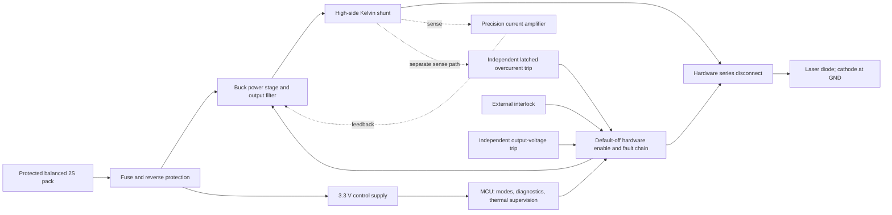

# Budget NUBM44 driver plan

Planning review: 2026-10-28. Author: Codex (AI review), requested by owner.

Develop a separate **two-cell synchronous buck driver**, retaining 4 A constant-current operation and the
protection functions of the existing design. Use the unrestricted board size to simplify assembly and buy
genuine parts in small quantities. **£60 per working driver is the spending ceiling, not a verified cost.**
Compare three and five working drivers: batch ceilings £180 and £300. The complete delivered cost is
`UNKNOWN` until the circuit, assembly process and supplier quotes are defined.

The owner accepts two Li-ion cells in series, has removed the size constraint and specified £60 per driver
(DD-29). The remaining figures below are proposed engineering targets unless attributed to an existing
requirement or manufacturer source. This is a development plan; the budget design has no schematic, PCB,
simulation or bench results. The existing A/B release gates describe those boards only.

## 1. What the earlier work established

| Finding | Consequence for the budget version |
|---|---|
| The original 1S range overlaps the laser's 3.8–5.2 V compliance window (DD-01). | A 1S buck cannot retain the specification. Accepting 2S makes a buck architecture possible and removes the need for the original four-switch stage. |
| QUOTE-01 matches all 30 evaluation BOM lines; arithmetic is correct. Five-board components 249.645, assembly 29.00, PCB 25.97, total 304.615. ISO currency remains UNKNOWN. | Preserve this as the comparison quote; obtain a firm GBP total before using it as a purchasing decision. |
| L1 alone is 126.790, 50.79% of the component quote. The exact Coilcraft reference is much lower; the reason is UNKNOWN. | Ask for an exact-MPN reprice first. A new design may cost more overall once development, extra prototypes and testing are counted. |
| If, and only if, QUOTE-01 is USD, FX-01 gives £229.25 for five, about £45.85 each before unknown UK landed costs. | £60 does not by itself require a redesign. Compare a corrected quote for the existing board against the new design at the first cost checkpoint. |
| UK distributor snapshots exist; no AliExpress Choice or UK eBay offer was qualified as a safer, cheaper complete purchase. | Prefer consolidated genuine supply for critical parts. A UK web address or seller name does not establish UK dispatch or provenance. |
| FP-POWERPAK / FP-RS1 remain open; AUD-PCB-06 records U3's exposed-pad discrepancy. | Review every new exact package and land pattern against its manufacturer document. Do not copy these unresolved footprints. |
| Audit work found R16 short-fault overload, a marginal tolerance case in the existing compensation and Q6 gate-rating concerns. | Recalculate fault power, loop compensation and gate voltages; old resistor values and protection thresholds are not a new design. |
| Project 450 demonstrates a two-cell buck concept, deliberate arming and a mechanical heat path (P450-01/02). | Reuse these ideas. Its page supplies neither a complete inspectable design package nor proof of our cost, regulation or fault performance. |
| Existing CAD passes and firmware tests are useful evidence for A/B; Gate G is still open. | Reuse the engineering process and tested state-machine behaviour. Qualify the budget hardware and its firmware adaptation separately. |

Detailed evidence: [pre-order review](../reports/pre-order-review.md),
[quote / GBP / UK sourcing review](../reports/bom-quote-sourcing-review.md),
[audit](../reports/comprehensive-project-audit.md),
[Project 450 notes](../research/project450-design-notes.md). New primary sources and dated price observations:
[BUD-01…14](../research/sources/budget-driver-sources.md), registered in the source index.

## 2. Working specification and cost boundary

| Item | Budget planning requirement | Basis / unresolved detail |
|---|---|---|
| Supply | Two conventional 4.2 V-charge Li-ion cells in series; assess 6.0–8.4 V at the driver | Owner accepts 2S. Operating range and UVLO are proposals; prove dropout with cable, reverse-protection and disconnect losses. |
| Pack protection | Protected, balanced 2S pack with individual-cell over/undervoltage protection, suitable current capability and fuse | A 6 V pack measurement alone cannot show that both cells are healthy. Pack/BMS and proper external 2S charger must be specified separately. |
| Output | True CC, 4.0 A maximum, laser compliance 3.8–5.2 V | Carry REQ-OUT-01/02 and DD-13. Maximum electrical load 20.8 W; optical output and diode lifetime remain unverified. |
| Accuracy / transients | ±5% at 4 A over 0–50 °C board temperature; maximum 4.4 A during normal startup, mode changes and reconnection | Carry REQ-OUT-03/05. Fault-trip current is a separate limit, not permission for normal overshoot. |
| Modes | Continuous and 2 Hz / 50% flashing, default off, deliberate enable and fault latch | Carry the existing behaviour. Start with a fixed hardware setpoint; adjustable-current modes are optional later work. |
| Efficiency | Proposed ≥94% at nominal 7.4 V / 4 A; report 6.0 and 8.4 V corners | New target/test point. DD-26's 4.0 V single-cell calculation does not verify it. |
| Protection | Independent hardware shutdown/interlock, backup overcurrent near 5 A, reverse polarity, UVLO, overvoltage/open-load, short-circuit, controlled discharge, thermal sensing and sensor-fault handling | Preserve functions; calculate thresholds, tolerances and response times for 2S. No protection is removed to meet the price. |
| Mechanics | No fixed outline; marked B+/B− input terminals, grounded laser cathode and accessible test points | The new board need not use spring/ring contacts. Original A/B polarity definitions remain in force for those boards. |
| Purchasing | £60 per accepted working driver; compare 3 and 5 units | Count all purchased quantities/spares, PCB/stencil, paid assembly/inspection, shipping, VAT and handling, including assembly rejects/rework. |

Working scope: the ceiling covers the assembled driver board and its procurement/inspection costs. It excludes
the laser diode, battery pack/BMS, charger, host/heatsink, reusable equipment and unpaid owner labour. Those
items still require a separate system-cost list; their prices are `UNKNOWN`. Existing equipment is not a
promise that assembly labour or test time is free. Obtain a second total if the owner wants these items within
the £60. Initially use an external protected pack and charger; integrated charging is outside this version.

## 3. Proposed architecture

This defines functions, not a finished schematic. The disconnect location, body-diode paths and sensing points
need a fault analysis. Include physical output-voltage sensing and discharge of stored energy on the laser
side as well as the converter side of the disconnect. A shared shunt is a common failure point even when two
different sensing ICs are used; explicitly analyse open sense traces and a shorted shunt.

### Power stage shortlist

| Candidate | Why consider it | Qualification / decision |
|---|---|---|
| **TPS54821RHLT** (lead proposal) | Integrated synchronous switches, 4.5–17 V input, 8 A class, external compensation, adjustable soft start; 14-pin 3.5 mm QFN (BUD-01). | An externally compensated controller gives us a way to design the added current-feedback loop. Its high-side current limit is 10.5–17 A, not a 5 A laser limit. It retains a hidden thermal pad and needs a qualified assembly process. |
| TPS54620 | 4.5–17 V, 6 A, current-mode buck with adjustable soft start (BUD-02). | Plausible alternative after full ripple/thermal checks; no demonstrated saving against the lead proposal. Exact package/suffix and current price UNKNOWN. |
| TPS56C215 | Project 450's synchronous buck; adjustable soft start (P450-02). | Keep as an alternative. D-CAP3 operation with an external current amplifier needs a justified stability design; the article is not proof of that loop. |
| TPS56628DDA | 6 A HSOIC-8 with exposed PowerPAD; accessible leads (BUD-03). | Not the lead choice: TI lists 85% maximum duty, while 6.0 V → 5.2 V plus the shunt already needs 87.3% before other losses. Adaptive timing/dropout and D-CAP2 current-feedback stability need proof or a higher minimum input. Fixed 1 ms soft start. |
| TPS56637 | Another 6 A buck (BUD-04). | VQFN-HR-10, not a SOIC alternative. Do not infer easier hand assembly from the part family. |

Do not buy a generic “5 A CC” module as the equivalent driver. A candidate module needs its exact controller,
schematic, genuine parts, sustained thermal rating, current-loop behaviour and independent fault protection
verified first. No such module is qualified here. A linear solution would dissipate approximately
`(8.4 − 3.8) × 4 = 18.4 W` at one corner before other losses, which conflicts with the efficiency goal.

### Sensing, control and protection

Use the existing **INA186A2IDCKR** as the conservative precision-amplifier starting point (PREORDER-07), with a
10 mΩ Kelvin shunt in a larger, reviewed package. The new converter's 0.6 V feedback reference requires a new
divider and compensation design. With gain 50 and a 4 A target, the ideal feedback attenuation would be
`0.6 / (50 × 0.010 × 4) = 0.30`; this is a feasibility calculation, not selected resistor values.

**INA180A2IDBVR** is a larger SOT-23 alternative to evaluate (BUD-07). Its 150 µV offset headline applies at
0 V common mode; the datasheet gives 500 µV at 12 V. Do not apply the better figure to a roughly 5 V high-side
measurement without justification. A conservative 500 µV allowance is already 1.25% of the 40 mV shunt signal,
before gain, temperature, divider, reference and shunt errors. Retain INA186 if the cheaper choice cannot meet
the complete ±5% budget. Genuine precision parts are a poor place to save pennies.

Add an **INA300AIDGSR** comparator as a proposal for the missing independent backup trip (BUD-06): a separate
shunt-sense path, latched alert and direct hardware shutdown. Calculate a tolerance-bounded threshold near
5 A and the complete shutdown energy. Its selectable 10 µs detection setting is not the total system
response time; the fast mode includes a noise adjustment in the threshold equation. Do not select its resistor
from `50 mV / 20 µA` alone. Its supply is 2.7–5.5 V, so it needs the control rail.

Specify a hardware series disconnect in the baseline fault study. Pulling EN low cannot isolate a failed-short
power switch; shutting down a buck also does not establish safe output-capacitor energy at reconnection.
Choose its FETs/driver, default-off bias and discharge path after calculating the fault cases. Exact MPNs and
cost are `UNKNOWN`. The converter's feedback-derived power-good/OV functions cannot serve as independent
physical output-voltage protection when feedback represents laser current. Retain an independent voltage trip.

Use **ATTINY1616-SN, SOIC-20** as the MCU proposal (PREORDER-08, BUD-12). It avoids U3's exposed-pad assembly,
but has different physical pin numbers from the existing VQFN. Preserve tested state-machine logic; review
every port/ADC/comparator connection and adapt the HAL, conversion scaling, fuses, clock and hold-up behaviour.
Provide a regulated **3.3 V** rail; regulator MPN is `UNKNOWN`. Never connect the 8.4 V pack directly to the MCU
or carry over the single-cell voltage divider. Verify clock capability at the chosen supply.

Re-rate every battery-connected component. **AO4407A** in SO-8 is a reverse-protection candidate, not an adopted
part: −30 V VDS, ±25 V VGS, maximum 17 mΩ at VGS = −6 V (BUD-08). There is no stated −4.5 V resistance guarantee;
prove drive and heating at minimum pack voltage, or choose another qualified FET. The original SiSS23DN's
±8 V gate rating is insufficient for an unclamped 8.4 V gate drive; Q6's ±6 V concern also needs a new solution
(PREORDER-02, LEAD-04). Review transient margin, gate clamps, cap voltage/bias derating and indicator short-fault
power. R4 and R16 values from the old design are not automatic selections for this circuit.

Preserve the mandatory board NTC's open/short fault handling, optional laser-NTC rules, hardware interlock,
default-off behaviour and latched watchdog/reset faults. Proposed board/laser thermal limits start from the
existing 85/60 °C requirements, subject to sensor placement and measured host temperatures. Pack UVLO and
restart thresholds need an approved 2S policy plus per-cell protection; doubling a firmware constant is not
enough. Keep external charging separate and emission inhibited during any future charging integration.

## 4. Initial electrical and assembly feasibility

These are transparent planning calculations, not generated design evidence or measurements. Assume a
400 kHz design point, 4.7 µH nominal inductance and the existing 4 A / 5.2 V maximum load. Final frequency,
inductance under DC bias/temperature and compensation are unselected.

| Calculation | Planning result | Limit of the result |
|---|---|---|
| Electrical output `4 × 5.2` | 20.8 W | Excludes sensing and disconnect losses. |
| Input `20.8 / (0.94 × Vin)` | 3.69 A at 6 V; 2.63 A at 8.4 V | Assumes the efficiency target is achieved; not measured input current or a pack rating. |
| Minimum ideal duty including 40 mV shunt drop `(5.2 + 0.04) / 6` | 87.33% | Add losses and cable sag before setting UVLO/dropout limits. |
| Ideal worst triangular buck ripple over the compliance range `Vin / (4Lf)` at 8.4 V | 1.12 A p-p at 4.2 V output | Inductor ripple, not laser current ripple. |
| Sensitivity: L −20%, f −10% | 1.55 A p-p; 4.78 A peak; 4.025 A RMS | Frequency −10% is an exploration assumption, not a guaranteed IC tolerance. Additional DC-bias/hot inductance loss UNKNOWN. |
| Shunt DC dissipation `4² × 0.010` | 0.160 W | Kelvin geometry, tolerance, temperature coefficient and fault-pulse rating still matter. |

**SRP1265A-4R7M** is the initial larger-inductor candidate (BUD-05): 4.7 µH ±20%, DCR 8.4 mΩ maximum at 25 °C,
13.5 A thermal-current rating and 28 A Isat defined at 20% inductance loss. This leaves a more useful starting
point for the converter's high internal fault-current limit than a coil whose saturation reference merely
equals that limit. Qualify the actual L-versus-current/hot behaviour and short-fault energy; catalogue Isat
does not certify the assembled driver's fault performance. Size is acceptable under the owner's new brief.

Use one assembly side, 0603/0805 general passives, larger precision resistors/shunt where appropriate, SOIC
MCU, accessible connectors, mounting holes and labelled test points. Keep the input switching loop short,
feedback/Kelvin traces quiet and the return plane continuous despite the unrestricted outline. Assess a
standard two-layer board first; quote four layers if electrical/thermal/layout review requires them. Neither
stack-up is approved yet. Avoid HDI only if manufacturer land/thermal-via requirements can actually be met.

The TPS54821 still needs stencil/reflow and thermal-pad inspection; this is not an all-through-hole hand-build.
Ask the assembler for its proposed land/paste/via process and priced inspection, including X-ray if required
by the package review. A SOIC MCU reduces the hidden-joint burden but does not eliminate it. Owner assembly
is a separate option only with suitable reflow/rework/inspection access; equipment cost and yield are UNKNOWN.
Mount the driver to a defined heat-spreading interface inspired by Project 450, with electrical isolation
where needed. Verify continuous operation in the actual host rather than relying on a large board alone.

A 200–250 ms current ramp from Project 450 is not automatically compatible with 2 Hz / 50% flashing: each on
window is only 250 ms. Select a ramp from measured overshoot and the intended optical envelope. No new ramp
duration or adjustable-current feature is adopted in this plan.

## 5. GBP cost plan and sourcing

The following are **dated primary-retailer search snapshots retrieved 2026-10-28**, not live offers. Indexed
pages were 2–5 months old and direct refetches failed. Current stock, UK dispatch, shipping and payable prices
are `UNKNOWN`. All four observations below explicitly exclude VAT. Quantities five/seven illustrate one
fitted part per board plus **two development spares per MPN** for batches of three/five. These spare counts
are engineering allowances, not PCBWay's accepted attrition quantities. No reel fee is assumed for cut tape.

| Role / proposed exact MPN | Seller / source | Observed unit GBP ex VAT, 1+ | Buy 5 for 3 boards | Buy 7 for 5 boards |
|---|---|---:|---:|---:|
| Buck / TPS54821RHLT | [DigiKey UK, BUD-09](https://www.digikey.co.uk/en/products/detail/texas-instruments/TPS54821RHLT/2797955) | £3.440 | £17.200 | £24.080 |
| Inductor / SRP1265A-4R7M | [DigiKey UK, BUD-10](https://www.digikey.co.uk/en/products/detail/bourns-inc/SRP1265A-4R7M/4876629) | £1.050 | £5.250 | £7.350 |
| Independent trip / INA300AIDGSR | [DigiKey UK, BUD-11](https://www.digikey.co.uk/en/products/detail/texas-instruments/INA300AIDGSR/7688269) | £1.130 | £5.650 | £7.910 |
| MCU / ATTINY1616-SN | [Farnell UK, BUD-12](https://uk.farnell.com/microchip/attiny1616-sn/mcu-8bit-20mhz-soic-20/dp/3052744) | £0.878 | £4.390 | £6.146 |
| **Partial purchase basket only** | Four roles; two sellers | **£6.498 per fitted set** | **£32.490** | **£45.486** |

These partial baskets omit the precision amplifier, shunt, disconnect/protection circuitry, regulator, sensors,
all other passives/connectors, PCBs, stencil, labour, inspection, tax and delivery. They cannot establish a
complete BOM cost or a saving. Compare a consolidated quote before splitting orders across sellers. Request
cut tape or tubes accepted by the assembler; choose exact packing suffixes in the new BOM. Manufacturer
samples are a possible development aid with availability/eligibility `UNKNOWN`, not a costed production source.

Use the following **spending allocations**, not supplier estimates, to judge whether the design is worth
continuing. Move money between categories only while keeping the complete batch total inside the ceiling.

| Allocation | Per working driver ceiling | Three drivers | Five drivers |
|---|---:|---:|---:|
| All components, including allocated purchased spares | £18 | £54 | £90 |
| PCBs and allocated stencil | £5 | £15 | £25 |
| Paid assembly, inspection and rework | £12 | £36 | £60 |
| VAT, all freight and handling | £15 | £45 | £75 |
| Contingency | £10 | £30 | £50 |
| **Total budget** | **£60** | **£180** | **£300** |

Actual delivered cost is `(all batch purchase + fabrication + assembly + inspection + freight + tax + rework)
/ accepted working drivers`. Include fixed setup charges and the price of unused bought parts. Never multiply
only the fitted BOM by three or five and call it the batch cost. Development respins must have a separately
visible allowance; the table is a first successful batch target, not a guarantee that the entire development
programme fits £180/£300. Total development spending is `UNKNOWN` until quoted and approved.

| Build route | Position now | Complete GBP total |
|---|---|---|
| Repriced original evaluation-board turnkey | Lowest development effort; resolve original footprints first. Seek L1 reprice, exact U1 price and firm 3-populated/5-populated quotes. | UNKNOWN; original five-board conditional £229.25 before unknown landed costs only if USD confirmed. |
| New 2S design, turnkey assembly | Preferred new-board production route to price; fewer external power switches and easier packages may help. | UNKNOWN for 3 and 5. Supplier minimum/setup/inspection may dominate. |
| New 2S design, selective consignment | Quote only if a genuine large saving survives owner-to-assembler shipping, spares, tape and fees. | UNKNOWN. Published PCBWay minimum/attrition ambiguities from the sourcing review still need written resolution. |
| New 2S design, owner assembly | Consider only with a credible QFN reflow and inspection process. Larger passives help; they do not make hidden joints inspectable by eye. | UNKNOWN including equipment, stencil, spares, rejects and rework; unpaid labour excluded but disclosed. |
| Marketplace parts / generic modules | No qualified AliExpress Choice or UK eBay basket for this new circuit. | UNKNOWN; no speculative marketplace saving included. |

Genuine sources are the recommendation for the converter, precision amplifier, comparator, shunt, setpoint
resistors, thermal sensor and protection FETs. Counterfeit/remarking or wrong-value parts here can defeat
current regulation, shutdown or temperature protection. L1 also needs verified inductance, bias and heating.
Small passive savings seldom justify separate consignment handling. Use AliExpress/eBay principally for
noncritical accessories once their specifications and total UK delivered cost are verified. No electrical
“straight swap” into A/B is approved by this plan.

## 6. Work packages and exit criteria

1. **Freeze the brief and obtain a cost comparison.** Record DD-29 and scoped REQ-BUD requirements; retain 2S,
   4 A and protections. Confirm pack/BMS/charger/host cost boundaries, minimum operating voltage, battery
   connector and whether three or five working drivers are needed. Obtain the original-board exact-MPN
   reprice and preliminary new-board assembly/setup/inspection terms in GBP. Exit: written scope and cost
   worksheet with all unknowns visible; stop or revise scope if the ceiling has no credible quoted path.
2. **Design the 2S circuit on paper and qualify exact parts.** Complete buck dropout/loss/ripple and hot/fault
   magnetics checks, full setpoint/trip error budgets, current-loop compensation, capacitor-energy/disconnect
   analysis, control-rail sequencing, pack UVLO policy and every pin/gate rating. Select the regulator, OVP,
   disconnect, shunt, caps and exact package suffixes. Exit: reviewed schematic proposal, calculations, complete
   purchasable BOM and updated quote; record architecture/part adoption in a new DD before implementation.
3. **Add an isolated budget variant to the source-driven workflow.** First extend the currently two-variant
   generators/validator to support variant-specific numeric/connectivity sources without changing A/B. Define
   its canonical source paths: proposed `engineering/design/budget-2s/parameters.yaml` and `connectivity.yaml`,
   with `hardware/budget-2s/placement.yaml`; update AGENTS.md/tooling documentation when that extension is
   implemented. Create reviewed symbols and lands. Do not overwrite shared A/B YAML to make a different
   circuit fit. Follow AGENTS.md: schematic/ERC/netlist, PCB DRC,
   power-layout review, exports and footprint report; calculations → simulations → refreshed layout evidence;
   sourcing regeneration where connectivity changes; final full validation. Exit: 0 unexplained ERC/DRC errors,
   no open nets, exact netlist/BOM match, independent package/paste/thermal-via review and hash-bound evidence.
4. **Verify control and faults before laser use.** Build switching/ripple and averaged loop models with their
   limitations declared. Sweep battery/Vf, hot/bias L, effective capacitance and tolerances; proposed loop
   criteria ≥45° phase / ≥10 dB gain margin. Test startup, flash, open/reconnected load, shorts, reverse input,
   interlock, CSA/sense faults, MCU stopped/reset, absent control rail and NTC open/short. Adapt HAL/ADC/hold-up
   and rerun host/register/mutation/target builds. Exit: documented model results, no fabricated pass, fault
   matrix identifying what only hardware can prove, plus a budget-specific bench plan and release reviews.
5. **Build a small controlled prototype batch.** Request final GBP turnkey and optional consignment quotes
   for 3 and 5 populated boards, including any required bare extras, all purchased spares, stencil, X-ray,
   shipping and taxes. Owner chooses and orders manually only after review. Bring up one board first on a
   rated dummy load and current-limited supply. Exit: inspected assembly and stable dummy-load regulation;
   proceed to the other boards only after resolving failures.
6. **Close physical qualification on the new variant.** Measure accuracy, ripple, normal peak current ≤4.4 A,
   efficiency, dropout, startup/flash/hotplug energy, independent fault-trip behaviour with stalled firmware,
   reverse/UVLO protection and temperatures in the actual host. Exercise balanced and imbalanced-pack cases
   with suitable test equipment. Record only real MEASURED results, tied to board revision/serial and firmware.
   Exit: approved budget-specific Gate G criteria met; actual batch spend divided by working units ≤£60 or
   an explicit owner-approved deviation. Original A/B bench records cannot close this gate.

No calendar duration is promised: engineering effort, supplier lead time, assembly capacity and likely respins
are `UNKNOWN`. Prioritise paper qualification and firm pricing before new CAD, then dummy-load prototypes.

## 7. Recommendation and remaining decisions

Proceed with the **2S buck feasibility track**, using TPS54821, a larger Bourns inductor, the existing precision
current-sense approach, a separate overcurrent trip, hardware disconnect/interlock and SOIC MCU as proposals.
Keep fixed 4 A and existing timing modes for the first version. Leave charging and adjustable power levels
for later. Larger components and standard fabrication are the intended savings, subject to a complete quote.

Before spending, the owner needs: the original quote's ISO currency and delivered GBP reprice; final choice
of three/five units; approved 2S pack and external charger; the complete new BOM/assembly quote and inspection
scope; and a credible dummy-load/thermal/fault test setup. Ask PCBWay to price the exact approved MPNs, accepted
cut-tape/tube/spare quantities, setup/consignment fees, lead time, no-substitution policy and UK landed charges.
Obtain written confirmation that three populated boards are allowed despite the published minimum. All new
parts/footprints and proposed changes require decisions and regeneration, not a sourcing-only substitution.

**Known total: no complete new-driver total is established.** The four-role reference purchase baskets are
£32.490 for three boards plus two spares per role, or £45.486 for five plus two, excluding VAT and delivery.
The £180/£300 batch budgets remain targets. The next implementation milestone is the reviewed circuit and
complete quote, not a manufacturing release. No order has been placed.
