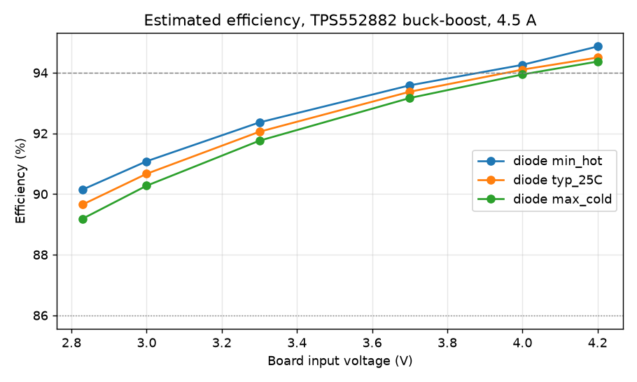
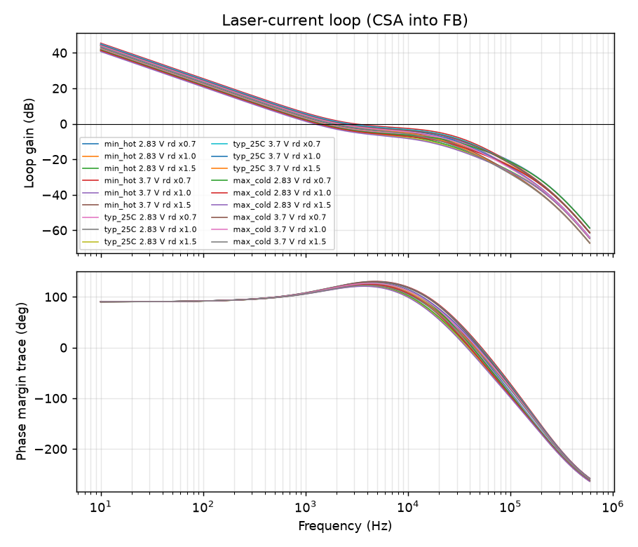

# Power-stage calculation results

Generated by `engineering/calculations/power_stage.py` from `engineering/design/parameters.yaml`.
Values are design estimates from datasheet parameters and first-order loss models. They are not
measurements. Gate G (physical validation) remains open until bench data exists.

## Checks

| Check | Value | Limit | Status | Note |
|---|---|---|---|---|
| Current setpoint worst-case tolerance | 3.5789 % | ≤ 5 % | **PASS** | linear sum of VREF, shunt, CSA gain/offset, divider, shunt TCR over 50 K |
| Nominal setpoint error | 0.48 % | ≤ 0.5 % | **PASS** |  |
| Backup current limit minimum above setpoint (no interference) | 4.8 A | ≥ 4.66105 A | **PASS** | ISP/ISN 48 mV min / shunt; must not clip normal regulation (margin factor: owner decision DD-36) |
| Average inductor current vs ILIM minimum (20 % margin) | 10.2907 A | ≤ 11.2386 A | **PASS** | worst operating avg 8.58 A; ILIM min 11.24 A |
| Peak inductor current vs Isat (30 % drop rating) | 9.6739 A | ≤ 14 A | **PASS** |  |
| Inductor RMS current vs Irms (20 C rise) | 8.599 A | ≤ 12.8 A | **PASS** | RMS = sqrt(avg^2 + ripple_pp^2 / 12) at the worst operating point |
| Efficiency at 4.0 V, typical diode (REQ-PWR-02 target >= 94 %, owner deviation DD-26) | 94.1015 % | ≥ 94 % | **PASS** | board-input to laser; estimate from loss model; brief asked > 95 % |
| Efficiency at 3.0 V, worst diode corner (REQ-PWR-03 target >= 86 %) | 90.2736 % | ≥ 86 % | **PASS** |  |
| Boost off-time vs minimum off-time | 881.927 ns | ≥ 145 ns | **PASS** |  |
| Reverse-polarity FET dissipation (worst point) | 0.6842 W | ≤ 0.7 W | **PASS** | PowerPAK 1212-8 on 4-layer pour at ~60 K/W (estimate); limit is an owner decision (DD-36), bench thermal T-test decides |
| Shunt dissipation vs 50 % of rating | 0.2025 W | ≤ 0.5 W | **PASS** |  |
| TPS552882 junction estimate at 50 C board (60 K/W assumed) | 110.891 C | ≤ 125 C | **PASS** | RthJA 47.5 K/W on JEDEC board; 60 K/W assumed for the 22 mm board; verify by test |
| Hardware UVLO falling threshold >= 2.80 V cell floor | 2.8292 V | ≥ 2.8 V | **PASS** |  |
| Hardware UVLO falling threshold below firmware cut-off | 2.8292 V | ≤ 2.85 V | **PASS** | firmware must act first; hardware is the backstop |
| OV backstop trip (min) above normal maximum output | 6.39 V | ≥ 5.364 V | **PASS** |  |
| Laser current ripple (p-p) as % of setpoint | 9.1683 % | ≤ 10 % | **PASS** | capacitive ripple / diode dynamic resistance; ESR adds a little |
| Output capacitor RMS current per capacitor | 1.0706 A | ≤ 3 A | **PASS** | 0805 22 uF X5R typically rated 2-4 A at 10 K rise |
| Current-loop phase margin (all corners) | 108.376 deg | ≥ 50 deg | **PASS** |  |
| Current-loop gain margin (all corners) | 12.5126 dB | ≥ 10 dB | **PASS** |  |
| Crossover below RHP zero / 5 | 2994.67 Hz | ≤ 9473.94 Hz | **PASS** |  |
| Crossover below CSA bandwidth / 3 | 2994.67 Hz | ≤ 12333.3 Hz | **PASS** |  |

## Laser current setpoint

- CSA gain × shunt = 0.500 V/A; FB divider ratio k = 0.5359
- Nominal setpoint: **4.4784 A**
- Tolerance contributions (%): vref 1.00, shunt 1.00, csa_gain 1.00, csa_offset 0.11, fb_divider 0.09, shunt_tcr_50K 0.38
- Worst-case sum **±3.58 %**, RSS ±1.78 %
- Independent ISP/ISN backup limit: 4.80 / 5.00 / 5.20 A (min/typ/max)

| Target (A) | R_FB_TOP exact (Ω) | E96 (Ω) | Resulting (A) |
|---|---|---|---|
| 3.0 | 2500.0 | 2487.9 | 2.9971 |
| 3.5 | 4583.3 | 4531.6 | 3.4876 |
| 4.0 | 6666.7 | 6651.5 | 3.9964 |
| 4.5 | 8750.0 | 8659.6 | 4.4783 |

## Operating points

| Diode corner | Vin (V) | Vf (V) | Vout node (V) | Region | Iin (A) | IL avg (A) | IL peak (A) | Efficiency |
|---|---|---|---|---|---|---|---|---|
| min_hot | 2.83 | 4.191 | 4.245 | boost | 7.39 | 7.39 | 8.30 | 90.1 % |
| min_hot | 3.0 | 4.191 | 4.245 | boost | 6.90 | 6.90 | 7.76 | 91.1 % |
| min_hot | 3.3 | 4.191 | 4.245 | boost | 6.19 | 6.19 | 6.93 | 92.4 % |
| min_hot | 3.7 | 4.191 | 4.245 | boost | 5.45 | 5.45 | 5.98 | 93.6 % |
| min_hot | 4.0 | 4.191 | 4.245 | boost | 5.00 | 5.00 | 5.34 | 94.3 % |
| min_hot | 4.2 | 4.191 | 4.245 | transition | 4.73 | 4.62 | 5.08 | 94.9 % |
| typ_25C | 2.83 | 4.515 | 4.569 | boost | 8.01 | 8.01 | 9.02 | 89.7 % |
| typ_25C | 3.0 | 4.515 | 4.569 | boost | 7.47 | 7.47 | 8.45 | 90.7 % |
| typ_25C | 3.3 | 4.515 | 4.569 | boost | 6.69 | 6.69 | 7.58 | 92.1 % |
| typ_25C | 3.7 | 4.515 | 4.569 | boost | 5.88 | 5.88 | 6.60 | 93.4 % |
| typ_25C | 4.0 | 4.515 | 4.569 | boost | 5.40 | 5.40 | 5.95 | 94.1 % |
| typ_25C | 4.2 | 4.515 | 4.569 | boost | 5.12 | 5.12 | 5.54 | 94.5 % |
| max_cold | 2.83 | 4.810 | 4.864 | boost | 8.58 | 8.58 | 9.67 | 89.2 % |
| max_cold | 3.0 | 4.810 | 4.864 | boost | 7.99 | 7.99 | 9.07 | 90.3 % |
| max_cold | 3.3 | 4.810 | 4.864 | boost | 7.15 | 7.15 | 8.16 | 91.8 % |
| max_cold | 3.7 | 4.810 | 4.864 | boost | 6.28 | 6.28 | 7.15 | 93.2 % |
| max_cold | 4.0 | 4.810 | 4.864 | boost | 5.76 | 5.76 | 6.49 | 93.9 % |
| max_cold | 4.2 | 4.810 | 4.864 | boost | 5.46 | 5.46 | 6.08 | 94.4 % |

### Loss breakdown: diode typ_25C, Vin 4.0 V

| Loss | W |
|---|---|
| q3_conduction | 0.259 |
| input_path_I2R | 0.231 |
| current_shunt | 0.203 |
| inductor_dcr | 0.168 |
| deadtime | 0.090 |
| boost_switching | 0.068 |
| inductor_core | 0.060 |
| q4_conduction | 0.048 |
| q1_on | 0.045 |
| gate | 0.045 |
| output_path_I2R | 0.041 |
| quiescent_and_aux | 0.009 |
| output_cap_esr | 0.006 |
| input_cap_esr | 0.000 |
| **total** | **1.274** |

### Loss breakdown: diode typ_25C, Vin 3.0 V

| Loss | W |
|---|---|
| input_path_I2R | 0.508 |
| q3_conduction | 0.360 |
| inductor_dcr | 0.323 |
| q4_conduction | 0.222 |
| current_shunt | 0.203 |
| deadtime | 0.124 |
| boost_switching | 0.091 |
| q1_on | 0.087 |
| inductor_core | 0.060 |
| gate | 0.045 |
| output_path_I2R | 0.041 |
| output_cap_esr | 0.020 |
| quiescent_and_aux | 0.008 |
| input_cap_esr | 0.001 |
| **total** | **2.091** |

## Hardware undervoltage lockout (EN/UVLO divider)

- Turn-on 3.079 V, turn-off 2.829 V (R_top 49900 Ω, R_bot 33200 Ω, 5 µA hysteresis current)

## Ripple

- Effective output capacitance 48.4 µF; output ripple 74.3 mV p-p at the worst boost point
- Laser current ripple ≈ 413 mA p-p; output capacitor RMS (total) 4.28 A

## Current loop

| Diode | Vin | rd scale | Zac (Ω) | fc (Hz) | PM (°) | GM (dB) | f_RHPZ (Hz) |
|---|---|---|---|---|---|---|---|
| min_hot | 2.83 | 0.7 | 0.1375 | 1693 | 116.6 | 12.5 | 55641 |
| min_hot | 2.83 | 1.0 | 0.187 | 1583 | 114.4 | 14.1 | 55641 |
| min_hot | 2.83 | 1.5 | 0.2695 | 1431 | 111.3 | 16.2 | 55641 |
| min_hot | 3.7 | 0.7 | 0.1375 | 2995 | 127.2 | 13.0 | 102494 |
| min_hot | 3.7 | 1.0 | 0.187 | 2677 | 123.9 | 14.5 | 102494 |
| min_hot | 3.7 | 1.5 | 0.2695 | 2299 | 119.5 | 16.7 | 102494 |
| typ_25C | 2.83 | 0.7 | 0.141 | 1521 | 114.4 | 12.8 | 51033 |
| typ_25C | 2.83 | 1.0 | 0.192 | 1431 | 112.4 | 14.4 | 51033 |
| typ_25C | 2.83 | 1.5 | 0.277 | 1305 | 109.6 | 16.6 | 51033 |
| typ_25C | 3.7 | 0.7 | 0.141 | 2548 | 124.5 | 13.4 | 94613 |
| typ_25C | 3.7 | 1.0 | 0.192 | 2324 | 121.4 | 15.0 | 94613 |
| typ_25C | 3.7 | 1.5 | 0.277 | 2041 | 117.3 | 17.1 | 94613 |
| max_cold | 2.83 | 0.7 | 0.141 | 1399 | 112.8 | 12.9 | 47370 |
| max_cold | 2.83 | 1.0 | 0.192 | 1324 | 110.9 | 14.5 | 47370 |
| max_cold | 2.83 | 1.5 | 0.277 | 1216 | 108.4 | 16.7 | 47370 |
| max_cold | 3.7 | 0.7 | 0.141 | 2270 | 122.4 | 13.6 | 88353 |
| max_cold | 3.7 | 1.0 | 0.192 | 2099 | 119.6 | 15.2 | 88353 |
| max_cold | 3.7 | 1.5 | 0.277 | 1874 | 115.9 | 17.3 | 88353 |

Model: averaged CCM boost-mode plant with the TPS552882 equivalent current-sense resistance (0.055 Ω),
INA186A2 bandwidth pole, gm error amplifier with Rc-Cc-Cp. Buck mode has no RHP zero and is less restrictive.

## Copper

- input_8A_1oz_dT20_mm: 3.675
- input_8A_2oz_dT20_mm: 1.838
- output_4A_1oz_dT20_mm: 1.532
- sheet_mohm_1oz_75C: 0.603
- via_0p3_mohm: 1.399
- vias_for_8A_0p3: 9

## Run time (typical diode, 90 % of rated energy usable)

- 18650 3000 mAh: ~26.8 min continuous
- 21700 4000 mAh: ~35.7 min continuous

