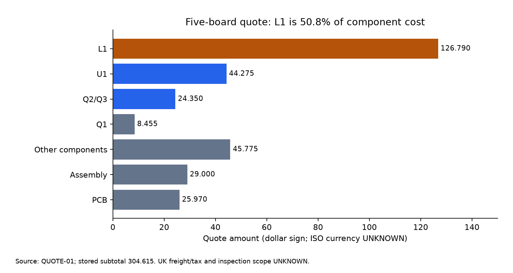

# Evaluation-board quote and sourcing review

2026-10-28. Reviewer: **Codex (AI review), requested by owner**. Ship-to: **UK**.
Reviewed `main` at `10a29cc`, on branch `review/bom-quote-sourcing`. No order, login, cart operation or
supplier message was made. Design sources, CAD, manufacturing packages and generated sourcing CSVs are unchanged.

**Recommendation: retain PCBWay turnkey assembly, request an exact-MPN L1 reprice, and hold payment until the
footprint dispositions are resolved.** Ask for three assembled boards plus the remaining bare boards as a
separate alternative; three-board acceptance and price are UNKNOWN. The only complete supplier subtotal is
**304.615 in the quote's currency (ISO code UNKNOWN)** for five boards. It is not a verified UK delivered total.
No AliExpress Choice offer met the evidence requirements, so there is no defensible AliExpress savings total.
If repricing fails, investigate **genuine Coilcraft L1-only consignment** before consigning the ICs or FETs.

## 1. Quote check

Source **QUOTE-01**: [original XLS](../documentation/T-1K2W1137524A-5units-BOM_PCBWay_template(2026-10-28).xls),
product **T-1K2W1137524A**, filename date 2026-10-28. SHA-256:
`8879e8906eefa4084cdd92df5f52ffa5eb7880dc75fb3d2069cef9b1157d7d4b`.
Compared with [exported BOM](../manufacturing/pcbway/evaluation-board/assembly/BOM_PCBWay_template.csv), SHA-256
`411651d84dda8953053ec9d4837da5ba1c5891a6c1323757e39a52613bcca329`.

The binary workbook was read as data with **system Python 3.11, `-I`, and xlrd 2.0.2 installed in an external
temporary directory**, outside the project venv. No project dependency was added. Reproduce using
[check_bom_quote.py](../automation/review/check_bom_quote.py), supplying an external `--reader-path`:

```powershell
rtk proxy "C:/Program Files/Python311/python.exe" -I automation/review/check_bom_quote.py --reader-path C:/Users/rober/AppData/Local/Temp/nubm44-quote-reader --quote "documentation/T-1K2W1137524A-5units-BOM_PCBWay_template(2026-10-28).xls" --bom manufacturing/pcbway/evaluation-board/assembly/BOM_PCBWay_template.csv --output reports/bom-quote-check.json
```

[Machine-readable check](bom-quote-check.json): **exit 0, zero discrepancies**. All nine original BOM fields
were compared on every line, including designator grouping, per-board count, manufacturer, exact MPN with
suffixes, description, footprint, assembly type and instructions. There are **30 lines, 29 priced SMT lines,
52 SMT placements per board**, plus J1. No missing/extra line, duplicate designator, substitution, quantity error
or arithmetic error was found. Every priced extension equals `unit price × per-board quantity × 5` within
1e-9 of the stored binary Excel number; decimal presentation below retains three places.

**J1 remains DNS**, qty 1 in the BOM, with blank prices and PCBWay's DNP acknowledgement. It is excluded from
the charged subtotal and SMT placements. Blank is not a verified zero purchase price: the owner still needs
a suitable spring. Its MPN and price are UNKNOWN. The rest of the quoted 53 BOM parts become 52 SMT placements.

| Workbook summary | Stored amount | Check |
|---|---:|---|
| Components | 249.645 | Sum of all 29 charged lines |
| Assembly | 29.000 | Quoted, scope to confirm |
| PCB | 25.970 | Quoted, stack-up/finish to confirm |
| Total, five units | **304.615** | 249.645 + 29 + 25.97 |

**Currency correction:** no USD/GBP/CNY or other currency code occurs in the cell text. However the used
monetary cell formats explicitly contain a **literal dollar sign**: line prices use `\$0.000`, summaries
`\$0.00`. Thus the sheet is dollar-labelled, with **ISO currency UNKNOWN**; it is not currency-free and cannot
be assumed to mean USD. The two-decimal summary display also requires an invoice rounding policy for the
three-decimal stored amounts. Confirm the final payable amount, exchange basis and taxes with PCBWay.

All per-line delivery-time cells are blank (**UNKNOWN**). Quote validity, UK freight, VAT/duty, inspection charges,
programming/testing and panelization inclusion are not established by the workbook. U1's note warns that its
final price is subject to the real price at order time; **8.855 each / 44.275 total is not locked**.

## 2. Cost breakdown and L1 investigation



| Line group | Five-board quote amount | % of component cost |
|---|---:|---:|
| L1, 5 × XGL5030-102MEC | **126.790** (25.358 each) | **50.79%** |
| U1, 5 × TPS552882RPMR | 44.275 (8.855 each) | 17.74% |
| Q2/Q3, 10 × SISS80DN-T1-GE3 | 24.350 (2.435 each) | 9.75% |
| Q1, 5 × SISS23DN-T1-GE3 | 8.455 (1.691 each) | 3.39% |
| All other charged components | 45.775 | 18.34% |

The four proposed expensive consignment lines together are **203.870**, or **81.66%** of components.
Most ordinary resistor lines cost less than 0.20 for the whole five-board job; consigning them trades tiny
savings for extra tape, counting and handling. C8 and C9 each cost 1.315; critical precision resistors and NTCs
deserve traceability even where their absolute cost is small.

**L1 price cause: UNKNOWN.** The workbook has no explanation, packaging/MOQ breakdown or supplier invoice.
The per-part/per-board multiplication is correct, so this is not a visible line-extension error. It does not
prove a full reel was charged, a decimal was misplaced, or PCBWay marked up the part.

On 2026-10-28 Coilcraft's [exact XGL5030-102MEC page](https://www.coilcraft.com/en-us/products/power/shielded-inductors/molded-inductor/xgl/xgl5030/xgl5030-102/)
advertised **USD 2.62 at quantity 1+** (SOURCE-01). It describes a 400-part full C reel and sub-reel tape, with
an optional **USD 25 leader/trailer charge**. Five fitted parts would be USD 13.10; a provisional eight-part
consignment allowance would be USD 20.96 before packing, freight and tax. The page's availability widget
contains conflicting/incomplete states, so **orderable quantity and UK delivered price are UNKNOWN**.
This is a price reference, not a fulfilment quote. If QUOTE-01 is USD, 25.358 is about **9.68 times** 2.62;
currency confirmation is necessary before treating that ratio as a cash comparison.

Ask whether 25.358 includes a broker minimum, tape preparation, imported freight, procurement minimum or a
manual-entry error, and request a reprice for the **same XGL5030-102MEC** from Coilcraft or its authorised
channel. These are questions, not established causes. XAL5030, XGL5030 with different suffixes, and generic
“1uH 5030” are substitutions even if the outline looks similar.

## 3. Quantities and every BOM line

[bom-sourcing-options.csv](bom-sourcing-options.csv) contains all 30 lines with safety roles, quote values,
5/3-board counts, spare assumptions, consignment rules, genuine-source references, and every required
AliExpress field (URL, seller, Choice yes/no, price, currency, lot quantity, UK shipping and retrieval date).

Table conventions:

- **Fitted** is the SMT requirement for five/three boards. A/B: PCBWay supplies those quantities; its own
  purchasing/attrition quantities are UNKNOWN, not silently zero. Owner component purchases are zero except J1.
- **C** illustrates consigning all four expensive lines L1/U1/Q1/Q2-Q3, **fitted + 3 per unique MPN**.
  These are provisional planning counts, not confirmed supplier minima or a shopping instruction. For the
  preferred **L1-only** variant, set owner purchases on U1/Q1/Q2-Q3 to zero; PCBWay supplies them. All other
  non-DNS lines are sourced by PCBWay. Required consignment overage remains UNKNOWN until agreed in writing.
- **D/E home** uses fitted + 2 per MPN as an explicit rework allowance, not a manufacturer minimum. E genuine
  consignment uses the same C counts; E genuine home assembly uses the D counts. Pack MOQ can increase them.
  J1 has **5/3 hand-fitted + 1 spare = 6/4**, pending host selection, and is never sent for SMT placement.
- Prices are QUOTE-01 dollar-labelled amounts with ISO currency UNKNOWN. The third price is a **three-board
  linear component model**, not a quote. No spare cost is added to turnkey prices because none is itemised.
- Risk is an assessment of **unverified marketplace counterfeit/remarking or mis-specification risk**, not a
  measured counterfeit rate or a claim about any particular seller. LOW counterfeit incentive does not mean
  a protection resistor has low safety consequence. Every Choice offer and delivered price below is UNKNOWN.

| Item / refs | Exact MPN | Fitted 5 / 3 | C owner plan 5 / 3 | D/E home plan 5 / 3 | PCBWay unit / 5 total / 3 model | Choice offer | Risk; recommendation |
|---|---|---:|---:|---:|---:|---|---|
| 1 U3 | `ATTINY1616-MNR` | 5 / 3 | 0 / 0 | 7 / 5 | 1.208 / 6.040 / 3.624 | UNKNOWN; search exact MPN + Choice UK | HIGH; Keep exact ATTINY1616-MNR from traceable supply; programme and verify fuses/firmware. U3 land DFM open. |
| 2 D3 | `BZX585-C6V2` | 5 / 3 | 0 / 0 | 7 / 5 | 0.201 / 1.005 / 0.603 | UNKNOWN; search exact MPN + Choice UK | HIGH; Keep exact Nexperia C6V2 SOD-523; reject generic 6V2/B variant; verify low-current trip on bench. |
| 3 C4,C5,C6,C14,C15,C17 | `CL05B104KO5NNNC` | 30 / 18 | 0 / 0 | 32 / 20 | 0.008 / 0.240 / 0.144 | UNKNOWN; search exact MPN + Choice UK | MEDIUM; Leave with PCBWay; exact voltage/dielectric/size; do not consign low-value passives. |
| 4 C8 | `CL05B563KO5NNNC` | 5 / 3 | 0 / 0 | 7 / 5 | 0.263 / 1.315 / 0.789 | UNKNOWN; search exact MPN + Choice UK | MEDIUM; Leave exact MPN with PCBWay; loop evidence is tied to this value. |
| 5 C7,C16 | `CL10A106KP8NNNC` | 10 / 6 | 0 / 0 | 12 / 8 | 0.081 / 0.810 / 0.486 | UNKNOWN; search exact MPN + Choice UK | MEDIUM; Leave with PCBWay; retain exact MPN and DC-bias/hold-up checks. |
| 6 C1,C2,C3,C10,C11,C12,C13 | `CL21A226MOQNNNE` | 35 / 21 | 0 / 0 | 37 / 23 | 0.306 / 10.710 / 6.426 | UNKNOWN; search exact MPN + Choice UK | MEDIUM; Leave with PCBWay; generic 22uF 0805 is not equivalent to the exact MPN. |
| 7 Q4,Q5,Q6 | `DMG1012T-7` | 15 / 9 | 0 / 0 | 17 / 11 | 0.193 / 2.895 / 1.737 | UNKNOWN; search exact MPN + Choice UK | HIGH; Traceable exact Diodes Inc DMG1012T-7; SOT-523, correct pinout; do not trade these disables for small savings. |
| 8 C9 | `GRM1555C1H681JA01D` | 5 / 3 | 0 / 0 | 7 / 5 | 0.263 / 1.315 / 0.789 | UNKNOWN; search exact MPN + Choice UK | MEDIUM; Leave exact C0G MPN with PCBWay. |
| 9 U2 | `INA186A2IDCKR` | 5 / 3 | 0 / 0 | 7 / 5 | 1.087 / 5.435 / 3.261 | UNKNOWN; search exact MPN + Choice UK | HIGH; Traceable exact INA186A2IDCKR; reject A1/A3 and package/gain substitutes. |
| 10 RS1 | `MCS1632R010FER` | 5 / 3 | 0 / 0 | 7 / 5 | 1.087 / 5.435 / 3.261 | UNKNOWN; search exact MPN + Choice UK | HIGH; Traceable Ohmite exact MPN; resolve land pattern; verify milliohms with Kelvin measurement. |
| 11 RT1 | `NCP15XH103F03RC` | 5 / 3 | 0 / 0 | 7 / 5 | 0.201 / 1.005 / 0.603 | UNKNOWN; search exact MPN + Choice UK | HIGH; Traceable exact Murata NCP15XH103F03RC; generic 10k NTC is a substitution. |
| 12 D1 | `PMEG4010CEJ,115` | 5 / 3 | 0 / 0 | 7 / 5 | 1.208 / 6.040 / 3.624 | UNKNOWN; search exact MPN + Choice UK | MEDIUM; Keep exact Nexperia PMEG4010CEJ,115 SOD-323F; markings alone do not authenticate. |
| 13 D2 | `RB521S30T1G` | 5 / 3 | 0 / 0 | 7 / 5 | 0.201 / 1.005 / 0.603 | UNKNOWN; search exact MPN + Choice UK | MEDIUM; Keep exact onsemi RB521S30T1G SOD-523; T1, T5G or another manufacturer are substitutions. |
| 14 R1,R10,R11,R12,R17,R18 | `RC0402FR-07100KL` | 30 / 18 | 0 / 0 | 32 / 20 | 0.005 / 0.150 / 0.090 | UNKNOWN; search exact MPN + Choice UK | LOW; Leave exact MPN with PCBWay; electrical consequence is high despite lower counterfeit incentive. |
| 15 R14,R15 | `RC0402FR-0710KL` | 10 / 6 | 0 / 0 | 12 / 8 | 0.008 / 0.080 / 0.048 | UNKNOWN; search exact MPN + Choice UK | LOW; Leave exact MPN with PCBWay. |
| 16 R4 | `RC0402FR-071K2L` | 5 / 3 | 0 / 0 | 7 / 5 | 0.026 / 0.130 / 0.078 | UNKNOWN; search exact MPN + Choice UK | LOW; Keep quoted value until owner adopts a fully validated design change. |
| 17 R13 | `RC0402FR-0720KL` | 5 / 3 | 0 / 0 | 7 / 5 | 0.007 / 0.035 / 0.021 | UNKNOWN; search exact MPN + Choice UK | LOW; Leave exact MPN with PCBWay. |
| 18 R16 | `RC0402FR-07220RL` | 5 / 3 | 0 / 0 | 7 / 5 | 0.017 / 0.085 / 0.051 | UNKNOWN; search exact MPN + Choice UK | LOW; Keep quoted line pending owner decision; 470 ohm is a proposed substitution, not approved. |
| 19 R3 | `RC0402FR-0727K4L` | 5 / 3 | 0 / 0 | 7 / 5 | 0.032 / 0.160 / 0.096 | UNKNOWN; search exact MPN + Choice UK | LOW; Leave exact MPN with PCBWay. |
| 20 R2,R6 | `RC0402FR-0733K2L` | 10 / 6 | 0 / 0 | 12 / 8 | 0.019 / 0.190 / 0.114 | UNKNOWN; search exact MPN + Choice UK | LOW; Leave exact MPN with PCBWay. |
| 21 R19 | `RC0402FR-0747KL` | 5 / 3 | 0 / 0 | 7 / 5 | 0.018 / 0.090 / 0.054 | UNKNOWN; search exact MPN + Choice UK | LOW; Leave exact MPN with PCBWay. |
| 22 R5 | `RC0402FR-0749K9L` | 5 / 3 | 0 / 0 | 7 / 5 | 0.014 / 0.070 / 0.042 | UNKNOWN; search exact MPN + Choice UK | LOW; Leave exact MPN with PCBWay. |
| 23 R7,R20 | `RC0402FR-074K7L` | 10 / 6 | 0 / 0 | 12 / 8 | 0.009 / 0.090 / 0.054 | UNKNOWN; search exact MPN + Choice UK | LOW; Leave exact MPN with PCBWay. |
| 24 R9 | `RT0402BRD0710KL` | 5 / 3 | 0 / 0 | 7 / 5 | 0.163 / 0.815 / 0.489 | UNKNOWN; search exact MPN + Choice UK | HIGH; Traceable Yageo precision RT series; keep exact tolerance, value and suffix. |
| 25 R8 | `RT0402BRD076K65L` | 5 / 3 | 0 / 0 | 7 / 5 | 0.126 / 0.630 / 0.378 | UNKNOWN; search exact MPN + Choice UK | HIGH; Traceable Yageo precision RT series; do not select alternate current-setting value silently. |
| 26 Q1 | `SISS23DN-T1-GE3` | 5 / 3 | 8 / 6 | 7 / 5 | 1.691 / 8.455 / 5.073 | UNKNOWN; search exact MPN + Choice UK | HIGH; PCBWay traceable exact Vishay; only consider genuine consignment after land-pattern acceptance. |
| 27 Q2,Q3 | `SISS80DN-T1-GE3` | 10 / 6 | 13 / 9 | 12 / 8 | 2.435 / 24.350 / 14.610 | UNKNOWN; search exact MPN + Choice UK | HIGH; PCBWay traceable exact Vishay; no generic low-Rds replacement; exact 8S land acceptance needed. |
| 28 U1 | `TPS552882RPMR` | 5 / 3 | 8 / 6 | 7 / 5 | 8.855 / 44.275 / 26.565 | UNKNOWN; search exact MPN + Choice UK | HIGH; Keep traceable exact TI TPS552882RPMR; avoid unverified marketplace ICs. |
| 29 J1 | `UNKNOWN` | 0 / 0 | 6 / 4 | 6 / 4 | DNS; not charged | UNKNOWN; search exact MPN + Choice UK | UNKNOWN; DNS: buy only after host spring selection; MPN/price UNKNOWN; preserve centre B+ and ring B- labels. |
| 30 L1 | `XGL5030-102MEC` | 5 / 3 | 8 / 6 | 7 / 5 | 25.358 / 126.790 / 76.074 | UNKNOWN; search exact MPN + Choice UK | HIGH; Ask PCBWay to reprice exact Coilcraft; genuine direct cut tape is the first consignment candidate, not generic 5020/5030. |

### AliExpress investigation and acceptance boundary

Exact-MPN searches on 2026-10-28 covered the cost drivers, diodes and control parts. Public AliExpress pages
could not be reliably retrieved, and search results did not supply a verifiable combination of seller,
**Choice**, exact option, pack count and UK shipping. No login, cart or purchase was attempted. Therefore
**all AliExpress prices, sellers, lot sizes, Choice flags and shipping amounts are UNKNOWN**. This does not
establish that no offers exist. Each CSV row supplies the exact search term; use the whole MPN including
`,115`, `T1G`, `-7`, `-MNR`, `RPMR`, `-T1-GE3` and precision-resistor suffixes.

Unqualified leads encountered via a secondary search archive were
[ATTINY1616-MNR](https://www.aliexpress.com/item/1005009465550468.html) and
[DMG1012T-7](https://www.aliexpress.com/item/1005011654039524.html). Direct seller/option details could not be
verified: seller, Choice, price, lot quantity and UK delivery are all UNKNOWN. Neither qualifies as a sourcing
recommendation; archived prices were not copied into the costing. Search phrases for the three diode lines
are `PMEG4010CEJ,115 Nexperia SOD323F Choice UK`, `RB521S30T1G onsemi SOD523 Choice UK` and
`BZX585-C6V2 Nexperia SOD523 Choice UK`.

The three manufacturer PDFs were downloaded **before the quote/sourcing assessment**, parsed with Python
`-I`, and are now indexed PREORDER-09/10/11 with local paths and SHA-256 values:

| Line | Primary-document acceptance checks | Marketplace rejection examples |
|---|---|---|
| D1 | PREORDER-09 pp.1-3: PMEG4010CEJ, 40 V / 1 A, SOD323F; 1 cathode / 2 anode, EP marking; retain order suffix `,115` | Generic PMEG4010/SS14, SOD323 rather than SOD323F, omitted/unverified suffix, wrong maker |
| D2 | PREORDER-10 p.1, Rev.12: onsemi RB521S30T1G, 30 V / 200 mA, SOD523; 1 cathode / 2 anode, 5M plus date/Pb-free marking | Unsuffixed obsolete T1, T5G packaging change, other maker using the same base text, generic “5M” |
| D3 | PREORDER-11 pp.1,2,4 Rev.9: BZX585-C6V2, SOD523, C-series ±5%, H1 marking; 5.89–6.51 V at 5 mA | B6V2 ±2% (E1), unspecified “6V2”, BZX584, wrong package or maker |

Package codes and marks are screening aids, not authenticity proof. D3's 5 mA data-sheet range is **not the
circuit trip threshold** at its low gate-bias current; Q6 threshold, Zener curve and bench verification matter.
No offered diode was authenticated and no substitution is approved.

### Safety roles and sourcing risks

The CSV records a role/consequence on every line. In particular, U1 regulates the laser and provides the
ISP/ISN backup limit; U2's gain/offset and RS1 plus R8/R9's values determine feedback/current. U3 runs modes and
thermal/battery supervision. Q1 protects reverse polarity; Q2/Q3 carry switching current. Q4/Q5/Q6 and D3 are
the hardware disable and over-voltage paths; RT1 provides board temperature sensing. L1's DCR and saturation
behaviour matter under high battery current. These lines warrant **HIGH** scrutiny for unverified supply.
Random functional checks cannot establish all fault behaviour or authenticate a die. Retain traceable exact
parts and the dummy-load/fault test programme; Gate G remains OPEN.

## 4. PCBWay consignment requirements

Read `research/pcbway-requirements.md` section 8 and local `mfg_pcbway_*` documents first, then rechecked the
linked primary pages on 2026-10-28. No order form was submitted.

| Topic | Published evidence and effect on this order |
|---|---|
| Partial consignment | Supported as partial turnkey/combo (MFG-02). Obtain a revised sourcing split and quote. |
| Tape/overage | MFG-03: non-reel SMT on a continuous strip. Ordinary 0603–2225/SOT/SOD/MELF: `max(50, fitted+30)`; 0201/0402/miniature: `max(100, fitted+50)`; expensive parts: 1–5 extra, subject to agreement. |
| Labels | MFG-09 Q5: each bag/box identifies BOM line, manufacturer/customer part number and quantity; include a packing list. Keep lots/MPNs separate. |
| Accepted packaging | MFG-02 lists reel, cut tape, tube/tray, loose and bulk. That broad capability does not establish an unconditional loose-QFN price or override specific feeder rules. Get approval for the exact packaging. |
| Feeder leader conflict | MFG-06 (PCBWay20181230-01, 2018-12-30) asks for >50 mm blank leader and mentions consuming 10–20 parts to load tape. Its small-job spare table differs from MFG-03 (including zero for >16-pin ICs). Do not assume U1/U3 need zero spare or that three loose spares solve a missing leader. Obtain one written per-line schedule and any waiver. |
| Unused parts | MFG-03 says not returned by default; MFG-09 permits return/storage by request. Specify valuable residual L1/U1/FET return and the fee. |
| Start/lead time | MFG-02 starts assembly timing after all parts and documents are ready; advertised range is 24 hours to weeks. This job's procurement, incoming inspection and assembly dates are UNKNOWN. |
| Promotion/fees | MFG-11 requires **all components supplied by PCBWay** for the 29 assembly promotion. Do not carry the quoted 29 into a partial-consignment total. Consignment handling, inspection, repacking, storage, rework and missing-part fees are UNKNOWN. |
| Shipping/customs | Receiving address, order/reference label, permitted direct supplier shipment, incoterms, declared value, importer responsibility, freight and import/return taxes are UNKNOWN. Obtain PCBWay's instructions before shipping. |

Sources: [MFG-03 special reminders](https://www.pcbway.com/assembly-special-remind.html),
[MFG-02 capabilities](https://www.pcbway.com/assembly-capabilities.html),
[MFG-06 preparation guide](https://www.pcbway.com/smt_ordering_guide.html),
[MFG-09 FAQ](https://www.pcbway.com/assembly-faq.html), and
[MFG-11 promotion conditions](https://www.pcbway.com/blog/PCB_Assembly/How_to_Get_29_PCB_Assembly_and_Meet_the_Requirements_e334dbde.html).
The CSV's alternative overage column is a planning aid only; SOT-523/SOD-523/SC70 miniature classification
needs confirmation. This is why buying just three/five of every part before speaking to PCBWay is premature.

## 5. Options comparison: five and three assembled boards

Let `P` be QUOTE-01's confirmed currency once supplied, `A_C` the revised partial-consignment assembly fee,
and `F` all unquoted freight/tax/packing/handling/inspection charges. Different currencies are **not added**.

| Option | Five assembled boards | Three assembled boards (five bare fabricated assumed) | Assessment |
|---|---|---|---|
| **A. Turnkey as quoted** | **304.615 P quoted subtotal**; delivered total UNKNOWN | No three-board quote; linear model 149.787 parts + 29 assembly + 25.970 PCB = **204.757 P**, conditional on unchanged rates/fees | Only complete five-board quote; U1 repricing and all exclusions still need confirmation. |
| **B. Fewer assembled, turnkey** | Same as A if five are populated | **UNKNOWN supplier total**; 204.757 P is only the same-fixed-cost model; apparent 99.858 P reduction is not a promised saving | Ask for 3 populated + 2 bare. Published MFG-02 minimum is 5 despite the ordering guide allowing 3; obtain written exception/quote. Unit prices and component overage need not scale. |
| **C1. L1-only consignment** | Rest parts 122.855 P + PCB 25.970 P = **148.825 P**, plus `A_C`, 8 provisional L1, and `F`. L1 reference USD 20.96, or 45.96 with optional leader charge | Rest parts model 73.713 P + PCB 25.970 P = **99.683 P**, plus `A_C`, 6 provisional L1 and `F`. L1 reference USD 15.72, or 40.72 with optional leader | Delivered totals UNKNOWN. If P=USD and other costs hold, L1 gross difference is 105.830/60.354 before leader, revised assembly and logistics; do not label that net savings. |
| **C2. L1/U1/Q1/Q2-Q3 consigned** | Rest parts + PCB **71.745 P** + `A_C` + owner 8 L1, 8 U1, 8 Q1, 13 Q2/Q3 + `F` | Rest parts model + PCB **53.435 P** + `A_C` + owner 6 L1, 6 U1, 6 Q1, 9 Q2/Q3 + `F` | Owner parts total UNKNOWN. Spare/handling costs can erase U1/FET savings; higher provenance/packing workload than C1. |
| **D. Bare boards + stencil, owner assembly** | PCB reference 25.970 P, revised bare-board quote/stencil UNKNOWN; component quantities fitted+2 in table | Same bare PCB reference, fit only 3; quantities fitted+2 in table | Entire total UNKNOWN: parts, stencil, tools, paste, inspection, rework, freight/tax and owner time unpriced. High assembly difficulty; not the recommended first prototype route. |
| **E. Genuine low quantity** | Use C counts for consignment or D counts for home assembly; verified partial price references below | Same counting method for 3; delivered total UNKNOWN | Preferred provenance over unverified AliExpress for critical lines; compare cut tape, not full-reel headline prices. |

The three-board model deliberately leaves PCB fabrication at five, consistent with the ordering guide's
minimum, and assumes no change to assembly charge. It is arithmetic sensitivity, not evidence PCBWay accepts
three or sources exactly three of each line. No option includes an invented AliExpress, spring, shipping or tax price.

### Genuine-source comparison (retrieved 2026-10-28)

| Exact part / source | Evidence | Five / three-board illustration | Remaining unknowns |
|---|---|---|---|
| L1 / Coilcraft direct, SOURCE-01 | USD 2.62 at 1+; optional USD 25 leader/trailer | C: 8/6 gives USD 20.96/15.72; D/E home: 7/5 gives USD 18.34/13.10 | Availability widget conflicting; UK freight/tax, tape acceptance, sample eligibility/quantity/delivery UNKNOWN |
| U1 / DigiKey, SOURCE-02 | Exact TPS552882RPMR cut tape, USD 7.04 at 1+, 5.425 at 10+; USD 7 Digi-Reel fee if selected | C: 8/6 gives USD 56.32/42.24; D/E home: 7/5 gives USD 49.28/35.20 | UK landed cost and stock at payment UNKNOWN; eight-part C cost already exceeds the five-fitted quoted 44.275 if quote is USD. Ten-pack break is a different purchase quantity. |
| U1 / LCSC C3188898, SOURCE-03 | Exact TI part page: $6.539 at 1+, $5.984 at 10+, min/multiple 1 | C: 8/6 parts is 52.312/39.234 in page dollar units; home 7/5 is 45.773/32.695 | ISO currency/session, UK/China destination costs and provenance paperwork to confirm; marketplace SKU equivalence is not sufficient |
| L1 / LCSC C6937849, LEAD-06 | Exact part listing exists | Price and orderable stock UNKNOWN: retrieved page did not expose reliable current pricing and older snapshots conflict | Request a current cut-tape quotation; do not use old regional search prices |
| U1/Q1/Q2-Q3 / Mouser | Exact-part product pages found; direct retrieval blocked/incomplete | **UNKNOWN**; cached regional prices are not a verified UK offer | Request current exact-MPN cut-tape quote, price breaks, packaging and delivered cost |
| Manufacturer samples | Coilcraft sample link exists; TI/Microchip sample eligibility not established | Quantity, approval, delivery and cost **UNKNOWN** | Do not fund an assembly plan on assumed free samples or include zero-cost sample parts in totals |

Sources: [Coilcraft exact L1](https://www.coilcraft.com/en-us/products/power/shielded-inductors/molded-inductor/xgl/xgl5030/xgl5030-102/),
[DigiKey exact U1](https://www.digikey.com/en/products/detail/texas-instruments/TPS552882RPMR/13577752),
[LCSC exact U1](https://www.lcsc.com/product-detail/C3188898.html),
[LCSC exact L1](https://www.lcsc.com/product-detail/C6937849.html),
[Mouser UK U1](https://www.mouser.co.uk/ProductDetail/Texas-Instruments/TPS552882RPMR?qs=81r%252BiQLm7BSBLProFZmPCQ%3D%3D).
These are seller-page observations, not reserved inventory or verification of every line's supply chain.
LCSC's authenticity statement is its own claim; manufacturer authorisation/lot traceability was not independently
verified for these listings. Obtain traceable supply paperwork before treating any marketplace stock as genuine.
For all other MPNs genuine-channel prices remain UNKNOWN; the CSV gives the exact requested part and the
per-option quantity. Request one consolidated distributor BOM quote rather than paying many separate shipping charges.

### Owner assembly feasibility

U1 is **VQFN-HR-26 with three centre pads** (LEAD-01, RPM0026A drawing); their distinct GND/SW2/VOUT
connections make hidden bridging especially consequential. U3 also has an exposed ground pad. Good perimeter
appearance or electrical continuity cannot inspect all hidden joints. The prior review recommends X-ray of
both U1/U3. A repeatable stencil/reflow process, magnification, rework ability and access to X-ray are relevant;
the owner's equipment/experience and inspection access are UNKNOWN. A soldering iron alone does not provide
a credible process for these hidden pads. Bare-plus-stencil is feasible for a suitably equipped experienced
assembler, but it is not established to be cheaper or suitable for this owner's first build. No laser bring-up
or bench measurements were performed by this review.

## 6. Open design decisions and quote lines affected

| Possible adopted decision | Quote line and exact consequence | Required follow-up |
|---|---|---|
| R16 220 → 470 ohm | Item 18, R16, presently RC0402FR-07220RL, 5 fitted / 0.085 P. Candidate naming RC0402FR-07470RL is **unverified**, price/stock UNKNOWN | Owner decision + design-decision entry, verify candidate manufacturer datasheet and fault dissipation; if package increases, footprint/layout/CPL may change too |
| R4 1.2 → 1.0 kohm | Item 16, R4, presently RC0402FR-071K2L, 5 fitted / 0.130 P. Candidate naming RC0402FR-071KL is **unverified**, price/stock UNKNOWN | Owner decision, full compensation/simulation checks, design-decision entry and regeneration |
| RS1 footprint remedy, AUD-PCB-06 | Item 10 MPN/qty need not change, but its footprint/description, paste and local copper do; current 5.435 P is no guarantee after re-quote | Correct authoritative footprint to Ohmite recommendation or secure exact written acceptance, then regenerate affected evidence/files |
| U3 footprint remedy, AUD-PCB-06 | Item 1 MPN/qty unchanged if only land geometry corrected; quoted footprint says EP1.7; replacement land/paste/CAD/export description need reissue | Microchip 1.80 mm centre land and 3.00 mm opposing pad-centre spacing; inspect clearance/paste and get DFM/X-ray approval |
| PowerPAK-8S disposition/fix | Items 26/27, Q1/Q2/Q3, same MPNs/qty if only footprint changes; BOM footprint/CPL/routing/stencil may change | Exact 8S compatible drawing or written acceptance; no invented replacement land geometry |
| Optional Q6 gate clamp | No approved part/value; could add a BOM line and copper changes | Owner/design decision and full design verification before any revised quote |

Any AliExpress candidate that is **not the exact manufacturer/MPN, including order suffix**, is a substitution.
Proposal does not authorise applying it. Adopted substitutions require the owner's decision, an entry in
`engineering/design-decisions.md`, authoritative source changes and **the complete regeneration chain in
AGENTS.md** (schematic/ERC/netlist, board DRC then layout, exports/JLC/footprint, calculations/simulations if
parameters change, sourcing rebuild if connectivity changes, then full validation and affected re-reviews).
No such change was applied here, and generated evidence was not edited to pass.

## 7. Recommendation, risks and questions for PCBWay

**Recommended option: A, revised exact-MPN turnkey**, asking PCBWay to reprice L1 from the manufacturer/authorised
channel and separately quote B (three populated/five fabricated). Known baseline: **304.615 quote-currency
subtotal for five**. Revised and UK delivered totals: **UNKNOWN**. This preserves professional assembly and
inspection while challenging the dominant cost. If the L1 reprice is unsuccessful, quote C1 with genuine
Coilcraft tape, written overage/leader acceptance and the new assembly/inspection fee. Do not buy unverified
AliExpress ICs, FETs, current-setting parts or protection components merely to obtain a Choice badge.

Main risks are the unresolved RS1/U3/8S lands, U1 price volatility, unknown final currency/landed cost,
unagreed consignment attrition, hidden-pad assembly quality and unmeasured protection/thermal performance.
The dashboard's board-less review rows are a confirmed presentation defect **AUD-DOC-05**; actual evaluation
release blockers remain FP-POWERPAK and FP-RS1, not the compact-only FP-U1/L1/ORIENT entries.

Before paying, the owner needs written answers to:

1. Which ISO currency, quote validity date, decimal rounding/final payable amount, UK freight and taxes apply?
   Which panelization, stencil, U1/U3 X-ray, programming and functional-test charges are included/excluded?
2. Why is exact XGL5030-102MEC 25.358 each? Give supplier, unit/pack quantity, MOQ and tape/freight breakdown;
   reprice the same part through Coilcraft/authorised distribution. Confirm no automatic substitutes.
3. Confirm all 30 BOM lines including J1 DNS, exact suffixes, U1's final price and parts availability/date codes;
   obtain approval before any manufacturer, suffix, value, tolerance or package change.
4. Accept/correct the exact RS1, U3 and selected PowerPAK-8S land/paste geometry in the reviewed package,
   with the written footprint dispositions and final placement/stencil previews. AI review sufficiency is
   the owner's decision; no CAD pass closes physical Gate G.
5. Quote three populated plus two bare boards and five populated boards on the same fabrication specification;
   confirm whether the published five-piece PCBA minimum can be waived and how overage/unit pricing changes.
6. For C1/C2, give **exact per-MPN delivery counts**, spare rule, blank leader/trailer needs, accepted tape/tray
   or loose-part format, labels/packing list, receiving address/reference and direct-distributor shipment policy.
   Resolve MFG-03 versus MFG-06 instead of purchasing to an assumed rule.
7. State partial-consignment assembly fee after any loss of promotion, incoming inspection/handling/storage/
   repacking/rework fees, responsibility for shortages/counterfeits, shipping/customs instructions, and return
   or storage of valuable excess parts. Confirm lead time starts only after parts/files are accepted.
8. Confirm four layers, 1.6 mm, **1 oz inner and outer**, ENIG, top-side assembly, correct layer order,
   X-ray records for U1/U3 and the test/programming plan. Do not treat this quote as approval of stack-up or DFM.

## 8. Verification and linked review

The three commands in the pre-order brief were run with the full installed toolchain: **pytest 207 passed**,
firmware six host suites / 531 checks, AVR target **4134 B flash / 59 B RAM**, **15/15 mutants killed**, and full
`validate.py` **exit 0**, 57 entries / 54 PASS / three known unchanged findings / zero new or changed failures.
Evaluation D/E/F pass their saved-evidence checks; release stays **DRAFT_REVIEW with two blockers**. Gate G OPEN.
No fresh PCB rewrite/DRC/export was performed because this review changes no design/CAD sources. All seven
section-9 baseline artifact hashes match. See [pre-order review addendum](pre-order-review.md#10-full-toolchain-and-local-document-addendum-2026-10-28)
for exact land remedies, full-toolchain results and the dashboard defect. Final documentation reruns:
**207 passed in 18.92 s; full validator exit 0, 57 entries/54 PASS/three known unchanged**, still two evaluation
blockers. The checker rejected a deliberately removed D2 MPN suffix in a temporary fixture (expected exit 1).
